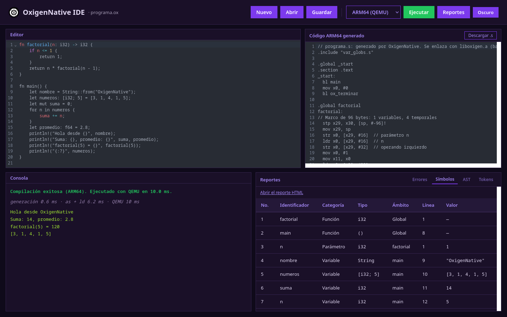

# OxigenNative

## Organización de Lenguajes y Compiladores 2 | Sección B

[](https://www.python.org/) [](https://www.dabeaz.com/ply/) [](https://developer.arm.com/) [](https://www.qemu.org/) [](https://fastapi.tiangolo.com/) [](https://graphviz.org/) [](https://astro.build/) [](https://portal.ingenieria.usac.edu.gt/) [](LICENSE)

**OxigenNative** es un compilador para un lenguaje educativo inspirado en Rust. Traduce cada
programa a **ensamblador ARM64 (AArch64)**, lo ensambla y enlaza con las herramientas GNU, y lo
ejecuta con **QEMU User Mode**. Se usa desde un **IDE web** que muestra en una sola vista el código
fuente, el ensamblador generado, la salida del programa y los reportes.



- **Lenguaje:** variables con tipo explícito o inferido (`i32`, `f64`, `bool`, `char`, `String`,
  arreglos `[T; N]` multidimensionales), mutabilidad con `mut`, operadores aritméticos,
  relacionales y lógicos, `if`, `while`, `loop`, `for`, `match`, bucles etiquetados, funciones
  recursivas, `println!` con `{}` y `{:?}`, y funciones embebidas (`len`, `contains`, `replace`,
  `split`, `reverse`, `to_uppercase`, `to_lowercase`, `push_str`, `typeof`, `random`).
- **Compilación real a ARM64:** sin libc. El programa se enlaza con una biblioteca propia,
  `liboxigen.a`, de 29 rutinas escritas en ensamblador, una por archivo, que solo usan llamadas al
  sistema Linux.
- **Reportes:** tabla de errores léxicos, sintácticos, semánticos y de ejecución, con línea,
  columna y fragmento del código; tabla de símbolos con su reporte HTML; y el AST dibujado con
  Graphviz.
- **Resiliencia:** el análisis continúa después de cada error y reporta todos en una sola
  ejecución. Un error de ejecución (división entre cero, índice fuera de rango) no detiene el
  programa.
- **Dos modos:** ARM64 con QEMU (por omisión) o el intérprete del Proyecto 1.

## Instalación rápida (Linux)

Requisitos: Python 3.14, [uv](https://docs.astral.sh/uv/), Node.js **22.12 o superior**,
Graphviz, binutils para AArch64 y QEMU User.

```sh
# Arch Linux
sudo pacman -S python uv graphviz nodejs npm aarch64-linux-gnu-binutils qemu-user
# Debian / Ubuntu (Node ≥ 22.12 con nvm si la versión del sistema es menor)
sudo apt install python3 graphviz nodejs npm binutils-aarch64-linux-gnu qemu-user

git clone https://github.com/Angelius6573/OLC2_B_P2_2S2026.git OxigenNative
cd OxigenNative
uv sync
(cd frontend && npm install)
uv run start.sh
```

Abrir `http://localhost:4321`. El paso a paso completo, con capturas, está en el
[manual de usuario](docs/manual/MANUAL_USUARIO.md).

Para compilar y ejecutar sin levantar el IDE:

```sh
.venv/bin/python -c "from api.compiler import compilar_codigo; r = compilar_codigo(open('docs/manual/ejemplos/01_ejemplo.ox').read()); print(r['output']); print(r['arm64']['asm'])"
```

## Documentación

- [Manual de usuario](docs/manual/MANUAL_USUARIO.md): instalación, uso del IDE, reportes y sesiones de ejemplo
- [Documentación técnica (índice)](docs/DOCUMENTACION_TECNICA.md)
  - [Arquitectura](docs/arquitectura.md)
  - [Diagramas de clases y de flujo](docs/diagramas.md)
  - [Reglas léxicas](docs/lexico.md) y [gramática formal](docs/gramatica.md)
  - [Generación de código ARM64](docs/arm64.md)
  - [Manejo de errores](docs/errores.md)
  - [Decisiones de diseño y desafíos](docs/decisiones.md)
  - [Modo intérprete](docs/ejecucion.md)
  - [Estructura de directorios](docs/estructura.md) y [API REST](docs/api.md)
  - [Guía de modificación del código](docs/modificacion.md)

## Tecnología

**Python** con **PLY** para el análisis léxico y sintáctico; generación directa de **ARM64** con
**GNU binutils** (`aarch64-linux-gnu-as`, `-ld`, `-ar`) y ejecución con **QEMU User Mode**;
**FastAPI + Uvicorn** para la API REST; **Graphviz** para el AST; y un IDE web con **Astro**,
**TypeScript** y **CodeMirror**. Desarrollado en Arch Linux.

---
<p align="center">
Copyright © 2026 Angel Raúl Herrera Chilel.
</p>
<p align="center">
El contenido de terceros utilizado en este proyecto se emplea únicamente con fines educativos. Todos los derechos pertenecen a sus respectivos propietarios.
</p>
