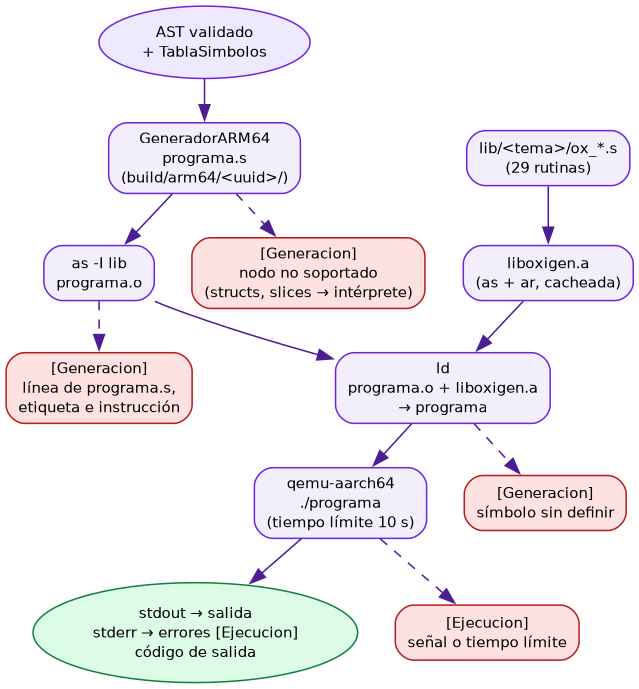

# Generación de código ARM64

**Volver al índice:** [Documentación técnica](DOCUMENTACION_TECNICA.md)

Este documento describe los métodos con los que OxigenNative traduce un programa a ensamblador
ARM64 (AArch64) y lo ejecuta: convenciones de registros, modelo de memoria, traducción de cada
construcción del lenguaje, la biblioteca de ejecución que sustituye a libc y la cadena
`as` → `ld` → QEMU.

## 1. Visión general

La traducción es **directa**, sin representación intermedia ni código de tres direcciones.
`GeneradorARM64` (`backend/arm64/generador.py`) es un recorredor del AST, como el
analizador semántico y el intérprete: cada nodo tiene un método `visitar_<Clase>` que escribe
instrucciones en un `Emisor`. Los métodos están repartidos por tema en `backend/arm64/generacion/`.

```
AST validado + TablaSimbolos
        │  GeneradorARM64.generar()
        ▼
programa.s ──as──► programa.o ──ld + liboxigen.a──► programa ──qemu-aarch64──► salida
```



El generador recibe solo programas **sin errores**. El checker ya validó tipos, ámbitos y
mutabilidad, y anotó en cada nodo su tipo (`nodo.tipo`) y el símbolo que usa (`nodo.sym_id`).
Por eso el generador no repite la resolución de nombres ni la inferencia de tipos.

Si encuentra un nodo que no sabe traducir (structs y slices, que son opcionales en el enunciado),
`_visitar_generico` lanza `ErrorGeneracion` con el nombre del nodo y su posición. El programa no
se compila a medias: la API lo ejecuta con el intérprete y lo informa en el panel ARM64.

### Archivos

| Archivo | Responsabilidad |
|---|---|
| `generador.py` | `GeneradorARM64`: estado, slots, temporales, errores de ejecución, `generar()` |
| `emisor.py` | Buffer de líneas: secciones, etiquetas, instrucciones, comentarios `//` |
| `layout.py` | `MarcoFuncion`: slots de 16 bytes, prólogo y epílogo |
| `literales.py` | Literales de texto en `.rodata` con etiqueta legible y longitud calculada por `as` |
| `programa.py` | `ProgramaARM64`: arma `programa.s` (`_start`, funciones, datos) |
| `errores.py` | `ErrorGeneracion` y códigos `ERR_*` leídos de `lib/var_globs.s` |
| `runtime.py` | Ensambla `lib/**/ox_*.s` y los empaqueta en `liboxigen.a` |
| `generacion/*.py` | Un módulo por bloque: constantes, variables, aritmética, control, funciones, impresión, match, arreglos, strings, tipos |
| `pipeline/*.py` | Un módulo por etapa: carpetas, herramientas, biblioteca, ensamblado, enlace, ejecución |
| `lib/<tema>/ox_*.s` | Biblioteca de ejecución: **una rutina por archivo** |

## 2. Convenciones

### 2.1 Registros

| Registro | Uso en el código generado | ¿Se preserva? |
|---|---|---|
| `x0`–`x7` | Argumentos y valor de retorno. Toda expresión deja su resultado en `x0` (y `x1` si es `String` o arreglo) | no |
| `x6` | Código de error de ejecución que recibe `ox_error` | no |
| `x8` | Número de llamada al sistema (`svc #0`) | no |
| `x9`–`x15` | Temporales del generador | no |
| `x16`–`x18` | No se usan (IP0, IP1 y registro de plataforma) | — |
| `x19`–`x28` | El código generado **no los usa**. Las rutinas de `lib/` que los necesitan los guardan y restauran | sí |
| `x29` | *Frame pointer*: base del marco de la función | sí |
| `x30` | *Link register*: dirección de retorno | sí |
| `sp` | Tope de la pila; siempre alineado a 16 bytes | sí |
| `d0`–`d7` | Temporales de aritmética `f64` | no |
| `xzr` | Cero: inicializa slots (`str xzr, [x29, #off]`) | — |

El estado del programa vive en memoria (marco de pila y heap), no en registros. Por eso el
generador no necesita `x19`–`x28` y no tiene que guardarlos en cada función.

**Dos desviaciones conscientes de AAPCS64:**

1. El código de error de ejecución viaja en `x6` y no en el registro de retorno. La convención
   viene del proyecto de Arquitectura de Computadoras del autor.
2. Los `f64` viajan como bits por `x0`–`x7`, no por `v0`–`v7`. El enunciado pide pasar
   los parámetros por `x0`–`x7`, y un solo banco de registros simplifica el generador. La
   conversión se hace con `fmov dN, xN` y `fmov xN, dN` donde se opera.

### 2.2 Comentarios y nombres

- Comentarios **siempre con `//`**, en línea completa, después de una instrucción o en bloques
  de varias líneas. El ejemplo de comentarios del enunciado usa `#` después de una instrucción; eso no ensambla en
  AArch64, porque `#` es el prefijo de los inmediatos (`as` responde *unexpected characters
  following instruction*). Ver [decisiones](decisiones.md#32-comentarios-con-).
- Etiquetas en español y legibles: `bucle_while_5`, `fin_while_5`, `si_no_3`,
  `fin_si_3`, `fin_sentencia_7`, `indice_valido_6`, `divisor_valido_1`, `fin_funcion_main`,
  `tabla_manejadores_2`, `texto_resultado`. Un único contador por programa evita repeticiones.
- Las funciones del usuario conservan su nombre (`main`, `sumar`). El runtime usa el prefijo `ox_`.
- Constantes con `.equ` en `lib/var_globs.s`: `WRITE 64`, `EXIT 93`, `GETRANDOM 278`,
  `STDOUT 1`, `TAMANIO_CELDA 16`, `ERR_DIVISION_CERO 2`, etc. El generador incluye ese archivo
  (`.include "var_globs.s"`), así que los códigos de error tienen una sola fuente.
- Direcciones con la pseudo-instrucción `ldr xN, =etiqueta`. El binario no es PIE, así que no
  hace falta `adrp` + `:lo12:`.

## 3. Modelo de memoria

### 3.1 Celda de 16 bytes

Todo valor ocupa una **celda de 16 bytes**, en la pila o en el heap:

| Tipo | `+0` | `+8` |
|---|---|---|
| `i32` | valor extendido en signo a 64 bits | — |
| `f64` | bits IEEE-754 | — |
| `bool` | 0 o 1 | — |
| `char` | punto de código Unicode | — |
| `String` | puntero a los bytes UTF-8 | longitud en bytes |
| `[T; N]` | puntero a la primera celda del bloque | cantidad de elementos de la dimensión exterior |

Un único tamaño simplifica todo el direccionamiento: el elemento `i` de un arreglo está en
`base + i * 16`, que en ARM64 es una sola instrucción (`add x0, x9, x11, lsl #4`).

### 3.2 Pila: el marco de cada función

Cada función tiene su propio marco. Las variables locales, los parámetros y los temporales viven
en **slots de 16 bytes** direccionados desde `x29`:

```
x29 + 0    x29 y x30 guardados (stp)
x29 + 16   primer slot
x29 + 32   segundo slot
...
```

- La **tabla de símbolos** del compilador (un registro `{nombre, tipo, contenido, mutable}` por
  variable, `SimboloVariable`) guarda en `offset` el desplazamiento del slot. En ejecución
  `nombre` y `mutable` ya no existen: solo queda el valor en `[x29, #offset]`.
- Los slots no se reutilizan. Dos declaraciones con el mismo nombre (*shadowing*) tienen `sym_id`
  distinto y por tanto slots distintos. La recursión funciona porque cada llamada crea su marco.
- El tamaño del marco solo se conoce al terminar de generar el cuerpo. El cuerpo se escribe en un
  emisor aparte y luego se envuelve con el prólogo y el epílogo.

**Prólogo y epílogo** (`MarcoFuncion.emitir_prologo` / `emitir_epilogo`). La forma depende del
tamaño, porque `stp` con pre-índice solo admite desplazamientos hasta 504:

| Tamaño del marco | Prólogo | Epílogo |
|---|---|---|
| ≤ 504 bytes | `stp x29, x30, [sp, #-N]!` · `mov x29, sp` | `ldp x29, x30, [sp], #N` · `ret` |
| ≤ 4095 bytes | `sub sp, sp, #N` · `stp x29, x30, [sp]` · `mov x29, sp` | `ldp x29, x30, [sp]` · `add sp, sp, #N` · `ret` |
| mayor | `ldr x9, =N` · `sub sp, sp, x9` · … | … · `ldr x9, =N` · `add sp, sp, x9` · `ret` |

Los slots se leen con `ldr`/`str` (desplazamiento hasta 32760). Para `String` y arreglos se usa
el par `ldp`/`stp` si el desplazamiento cabe (hasta 504) y dos instrucciones si no.

### 3.3 Heap

Las cadenas que se construyen en ejecución y los bloques de los arreglos van al heap: 8 MiB
reservados en `.bss` por `ox_reservar` (`lib/memoria/ox_reservar.s`). Es un *bump allocator*: el
puntero global `ptr_heap` avanza en múltiplos de 16 y nunca retrocede. El bloque entregado está
en cero, porque `.bss` lo está y nada se libera. Si el heap se agota, `ox_reservar` reporta
`ERR_SIN_MEMORIA` y termina el programa con código 1; es el único error de ejecución crítico.

Los literales de texto viven en `.rodata` y nunca se modifican. Toda operación que produce texto
reserva un bloque nuevo, así que compartir punteros entre variables es seguro.

## 4. Traducción de las construcciones

### 4.1 Contrato de una expresión

- El resultado queda en `x0`; para `String` y arreglos, `x0` = puntero y `x1` = longitud.
- Un `i32` se normaliza con `sxtw x0, w0` después de `+ - * neg`, para que se comporte como un
  entero de 32 bits con desbordamiento envolvente.
- En una operación binaria se evalúa el lado izquierdo, se guarda en un **temporal del marco**, se
  evalúa el derecho y se recarga el izquierdo (izquierdo en `x9`, derecho en `x11`). `sp` nunca se
  mueve a mitad de una expresión. Por eso un error de ejecución puede saltar desde cualquier punto
  de la expresión sin desbalancear la pila.

Ejemplo: `let x: i32 = 10; let y = x + 5;`

```asm
// let x: i32 -> [x29, #16]
  mov x0, #10
  str x0, [x29, #16]  // x
// let y: i32 -> [x29, #32]
  ldr x0, [x29, #16]  // x
  str x0, [x29, #48]  // operando izquierdo
  mov x0, #5
  mov x11, x0
  ldr x9, [x29, #48]
  add x0, x9, x11
  sxtw x0, w0
  str x0, [x29, #32]  // y
```

### 4.2 Literales

| Literal | Código |
|---|---|
| Entero entre −65535 y 65535 | `mov x0, #10` |
| Entero mayor | `ldr x0, =123456789` (*literal pool*) |
| `f64` | `ldr x0, =0x4004000000000000  // 2.5` (bits IEEE-754) |
| `bool` / `char` | `mov x0, #1` / `mov x0, #97` |
| Cadena | `ldr x0, =texto_hola` · `mov x1, texto_hola_len` |

Las cadenas van a `.rodata` con una etiqueta derivada de su contenido. Las cadenas iguales
comparten etiqueta, y la longitud la calcula el ensamblador:

```asm
.section .rodata
texto_resultado: .ascii "Resultado: "
  .equ texto_resultado_len, .-texto_resultado
```

### 4.3 Operadores

| Operación | `i32` | `f64` |
|---|---|---|
| `+ - *` | `add` / `sub` / `mul` + `sxtw` | `fadd` / `fsub` / `fmul` |
| `/` | `sdiv w0, w9, w11` (trunca hacia cero) | `fdiv` |
| `%` | `sdiv` + `msub`, con ajuste al signo del divisor | `a - frintm(a / b) * b` |
| `-x` | `neg` + `sxtw` | `fneg` |
| `== != < <= > >=` | `cmp` + `cset x0, <cond>` | `fcmp` + `cset` (`mi`, `ls`, `gt`, `ge`, `eq`, `ne`) |
| `&&` / `\|\|` | corto circuito: `cbz` / `cbnz` hacia `fin_logico_N` | — |
| `!` | `eor x0, x0, #1` | — |
| `String + String` | `bl ox_concatenar` | — |
| `String * i32` | `bl ox_repetir` | — |
| `String == String`, `<`… | `bl ox_comparar_texto` y `cset` | — |

Un operando `i32` mezclado con `f64` se promueve con `scvtf`. El módulo sigue la regla del
intérprete (resultado con el signo del divisor): `-7 % 2 = 1`.

**División y módulo por cero.** Antes de `sdiv` o `fdiv` se comprueba el divisor:

```asm
  cbnz w11, divisor_valido_1
  mov x6, ERR_DIVISION_CERO
  mov x0, #4   // línea
  mov x1, #13  // columna
  bl ox_error
    b fin_sentencia_2
divisor_valido_1:
  sdiv w0, w9, w11  // trunca hacia cero: solo la parte entera
```

### 4.4 Variables y asignación

- `let x = v;` evalúa `v` y lo guarda en el slot de `x`. Sin valor, el slot recibe el valor por
  defecto (`0`, `0.0`, `false`, `'\0'`, `""`, o un bloque en cero para un arreglo).
- `x = v;` y `x op= v;` evalúan y guardan en el mismo slot. La mutabilidad ya la validó el checker,
  así que no genera código.
- Si un error de ejecución salta el valor de un `let`, ese camino guarda el valor por defecto, para
  que una variable declarada dentro de un bucle no conserve el valor de la vuelta anterior.

### 4.5 Control de flujo

```asm
// if c { A } else { B }
  <c en x0>
  cbz x0, si_no_3
  <A>
    b fin_si_3
si_no_3:
  <B>
fin_si_3:

// while c { C }
bucle_while_5:
  <c en x0>
  cbz x0, fin_while_5
  <C>
    b bucle_while_5
fin_while_5:
```

- `loop` es un `while` sin condición. `break` salta a `fin_*` y `continue` al inicio (o al paso
  del `for`). El generador mantiene una pila de bucles con la etiqueta del usuario, de modo que
  `break 'externo;` salta al bucle correcto.
- `for i in a..b` evalúa `a` y `b` una sola vez (`b` en un temporal) e incrementa en
  `paso_for_N`. `for x in arreglo` recorre con un índice oculto.
- `match` es una cadena de comparaciones: cada brazo `caso_match_N_k` compara con su patrón
  (`cmp` o `fcmp` + `cset x0, eq`) y salta con `cbz` al brazo siguiente si no coincide. `_` es el
  caso por defecto. Los patrones `String` usan `ox_comparar_texto`. Una tabla de saltos no aporta
  nada aquí, porque los patrones son literales sueltos y no un rango denso.

### 4.6 Funciones

- Los argumentos se reparten en orden: un escalar usa un registro de `x0`–`x7`; un `String` o
  arreglo usa dos registros consecutivos. Lo que no cabe va a la pila: el llamador hace
  `sub sp, sp, #16k`, guarda cada argumento en `[sp, #16i]`, llama con `bl` y libera con `add sp`.
  La función llamada lo lee en `[x29, #tamaño_del_marco + 16i]`.
- Al entrar, la función copia sus parámetros a sus slots. Así cada llamada tiene sus propias
  copias y la recursión funciona.
- `return v;` deja `v` en `x0`/`x1` y salta a `fin_funcion_<nombre>`, donde está el epílogo.
- `main` es una función más. `_start` la llama y luego termina el proceso con `ox_terminar`
  (`svc #0` con `EXIT`).

```asm
_start:
  bl main
  mov x0, #0
  bl ox_terminar
```

### 4.7 `println!` con tabla de manejadores

Cada `println!` genera en `.rodata` una **tabla de punteros a los manejadores** de sus segmentos,
y los despacha con `blr`. Los argumentos se evalúan antes, en orden, en temporales del marco:

```asm
// println!("Resultado: {}", y);
  ldr x0, [x29, #32]  // y
  str x0, [x29, #96]  // argumento de println!
  ldr x9, =tabla_manejadores_2
  ldr x10, [x9, #0]   // ox_print
  ldr x0, =texto_resultado
  mov x1, texto_resultado_len
  blr x10
  ldr x9, =tabla_manejadores_2
  ldr x10, [x9, #8]   // ox_print_i32
  ldr x0, [x29, #96]
  blr x10
  ldr x9, =tabla_manejadores_2
  ldr x10, [x9, #16]  // ox_print_nl
  blr x10

.section .rodata
  .align 3
tabla_manejadores_2:
  .quad ox_print
  .quad ox_print_i32
  .quad ox_print_nl
```

| Tipo | `{}` | `{:?}` |
|---|---|---|
| `i32` | `ox_print_i32` | `ox_print_i32` |
| `f64` | `ox_print_f64` | `ox_print_f64` |
| `bool` | `ox_print_bool` | `ox_print_bool` |
| `char` | `ox_print_char` (UTF-8) | `ox_print_char_debug` → `'a'` |
| `String` | `ox_print_string` | `ox_print_string_debug` → `"a"` |
| arreglo | `ox_print_array` con su descriptor | igual |

Hay tres formas: solo literal; formato con `{}`/`{:?}`, sustituidos de izquierda a derecha; y
valores directos (`println!(a, b)`), separados por un espacio.

`ox_print_f64` redondea a seis decimales y quita los ceros sobrantes: `2.5` → `2.5`,
`2.0` → `2`, `0.0` → `0.0` (valor por defecto de un `f64`).

### 4.8 Arreglos en row-major

Un arreglo multidimensional es **un solo bloque contiguo** en el heap, en orden **row-major**
(por filas). `[[i32; 3]; 2]` son 6 celdas seguidas. El valor del arreglo es
`{puntero, cantidad de elementos de la dimensión exterior}`.

`m[i][j]` se calcula en dos pasos. `m[i]` es una *vista* de la fila (sin copiar):
`{base + i · C · 16, C}`, donde `C` es el número de celdas por fila, conocido por el tipo
estático. Luego `[j]` suma `j · 16`. El resultado es la fórmula del enunciado,
`base + (i · C + j) · 16`:

```asm
  cmp x11, x10              // índice contra la longitud
    b.lo indice_valido_6
  mov x6, ERR_INDICE_FUERA
  bl ox_error
    b fin_sentencia_7
indice_valido_6:
  mov x12, #32
  madd x0, x11, x12, x9     // row-major: i * celdas por fila
  ...
indice_valido_8:
  add x0, x9, x11, lsl #4   // + j * 16
  ldr x0, [x0]
```

- Cada acceso comprueba el límite (`cmp` + `b.lo`, sin signo, así que un índice negativo también
  falla) y reporta `ERR_INDICE_FUERA` si se sale.
- Un literal reserva el bloque completo con `ox_reservar` y escribe cada hoja en su posición
  lineal. `[v; n]` reserva `n` posiciones y copia `v` en cada una (cada fila es independiente).
- Asignar un arreglo o pasarlo como argumento comparte el bloque (semántica de referencia, igual
  que el intérprete). `m[1] = fila` copia las celdas.
- `ox_print_array` recibe un descriptor en `.rodata` con el manejador del elemento y su forma, y
  se llama a sí misma para cada dimensión.

### 4.9 Strings y funciones embebidas

| Construcción | Código |
|---|---|
| `String::new()` | `{0, 0}` |
| `String::from("x")` | puntero a `.rodata` + longitud |
| `s.push_str(t)` | `ox_concatenar` y guarda el resultado en `s` |
| `s.len()` | `ox_len` (cuenta caracteres UTF-8); en arreglos, `mov x0, x1` |
| `contains` / `replace` / `split` | `ox_contains` / `ox_replace` / `ox_split` (con `ox_buscar_texto`) |
| `to_uppercase` / `to_lowercase` | ASCII y letras Latin-1 de dos bytes (`á` → `Á`, `ñ` → `Ñ`) |
| `reverse()` | `ox_reverse` (por caracteres, sin romper UTF-8) o `ox_reverse_array` (en sitio) |
| `random(a, b)` | `ox_random`: xorshift64 con semilla de la llamada `getrandom`; rango inclusivo |
| `typeof(x)` | el tipo es estático: se emite el literal (`"i32"`, `"[i32; 3]"`) |

## 5. Errores de ejecución

Los errores de ejecución **no detienen el programa** (resiliencia). El código salta a
`fin_sentencia_N`, al final de la sentencia que falló, y el programa continúa:

1. `mov x6, ERR_*`, la línea en `x0` y la columna en `x1`.
2. `bl ox_error` escribe en **stderr** `[Ejecucion] Línea L, Columna C: mensaje`.
3. `b fin_sentencia_N` salta el resto de la sentencia: un `println!` cuyo argumento falló no imprime.

La API lee esas líneas de stderr y las pone en la tabla de errores con su posición.

| Código | Causa |
|---|---|
| `ERR_INDICE_FUERA` (1) | índice fuera de los límites |
| `ERR_DIVISION_CERO` (2) | `/` entre cero (`i32` y `f64`) |
| `ERR_MODULO_CERO` (3) | `%` entre cero |
| `ERR_SIN_MEMORIA` (4) | heap agotado: el único crítico, termina con código 1 |

## 6. Biblioteca de ejecución `liboxigen.a`

El programa no usa libc: solo llamadas al sistema Linux (`write`, `exit`, `getrandom`). Las 29
rutinas viven en `backend/arm64/lib/`, **una por archivo**, con sus propios textos en `.rodata`:

| Tema | Rutinas |
|---|---|
| `sistema/` | `ox_print`, `ox_print_err`, `ox_terminar` |
| `conversion/` | `ox_int_to_str` |
| `impresion/` | `ox_print_nl`, `ox_print_i32`, `ox_print_f64`, `ox_print_bool`, `ox_print_char`, `ox_print_char_debug`, `ox_print_string`, `ox_print_string_debug`, `ox_print_array` |
| `memoria/` | `ox_reservar`, `ox_copiar` |
| `strings/` | `ox_concatenar`, `ox_repetir`, `ox_comparar_texto`, `ox_buscar_texto` |
| `embebidas/` | `ox_len`, `ox_contains`, `ox_replace`, `ox_split`, `ox_to_uppercase`, `ox_to_lowercase`, `ox_reverse`, `ox_reverse_array`, `ox_random` |
| `errores/` | `ox_error` |

`runtime.py` ensambla cada archivo y los empaqueta con `ar` en `liboxigen.a`. El enlazador solo
extrae los objetos que el programa usa, así que el binario no carga rutinas sin usar. La biblioteca
se construye una vez en `build/arm64/` y se reconstruye sola cuando cambia algún `.s` de `lib/`.

## 7. Ensamblado, enlace y ejecución

Cada compilación trabaja en su propia carpeta `build/arm64/<uuid>/` (se conservan las 20 más
recientes):

```sh
aarch64-linux-gnu-as -I backend/arm64/lib -o programa.o programa.s
aarch64-linux-gnu-ld -o programa programa.o build/arm64/liboxigen.a
qemu-aarch64 ./programa
```

| Etapa | Módulo | Si falla |
|---|---|---|
| Generación | `pipeline/compilar.py` | `[Generacion]` con el nodo no soportado; la API ejecuta con el intérprete |
| Ensamblado | `pipeline/ensamblado.py` | `[Generacion]` con la línea de `programa.s`, la etiqueta que la contiene y la instrucción |
| Enlace | `pipeline/enlace.py` | `[Generacion]` con el símbolo sin definir |
| Ejecución | `pipeline/ejecucion.py` | `[Ejecucion]`: errores de `ox_error`, señal (`SIGSEGV`) o tiempo límite (10 s) |

QEMU corre sin volcados de memoria (`RLIMIT_CORE = 0`). Se mide el tiempo de cada etapa, y la
consola de la GUI lo muestra.

## 8. Ejemplo de entrada y salida

Entrada:

```rust
fn sumar(a: i32, b: i32) -> i32 {
    return a + b;
}

fn main() {
    let x: i32 = 10;
    let y = sumar(x, 5);
    if y > 12 {
        println!("Resultado: {}", y);
    }
}
```

`programa.s` generado (completo):

```asm
// programa.s: generado por OxigenNative. Se enlaza con liboxigen.a (backend/arm64/lib/).
.include "var_globs.s"

.global _start
.section .text
_start:
  bl main
  mov x0, #0
  bl ox_terminar

.global sumar
sumar:
// Marco de 64 bytes: 2 variables, 1 temporales
  stp x29, x30, [sp, #-64]!
  mov x29, sp
  str x0, [x29, #16]  // parámetro a
  str x1, [x29, #32]  // parámetro b
  ldr x0, [x29, #16]  // a
  str x0, [x29, #48]  // operando izquierdo
  ldr x0, [x29, #32]  // b
  mov x11, x0
  ldr x9, [x29, #48]
  add x0, x9, x11
  sxtw x0, w0
    b fin_funcion_sumar
  mov x0, #0  // sin return: valor por defecto
  mov x1, #0
fin_funcion_sumar:
  ldp x29, x30, [sp], #64
  ret

.global main
main:
// Marco de 112 bytes: 2 variables, 4 temporales
  stp x29, x30, [sp, #-112]!
  mov x29, sp
// let x: i32 -> [x29, #16]
  mov x0, #10
  str x0, [x29, #16]  // x
// let y: i32 -> [x29, #32]
  ldr x0, [x29, #16]  // x
  str x0, [x29, #48]  // argumento
  mov x0, #5
  str x0, [x29, #64]  // argumento
  ldr x0, [x29, #48]
  ldr x1, [x29, #64]
  bl sumar
  str x0, [x29, #32]  // y
  ldr x0, [x29, #32]  // y
  str x0, [x29, #80]  // operando izquierdo
  mov x0, #12
  mov x11, x0
  ldr x9, [x29, #80]
  cmp x9, x11
  cset x0, gt
  cbz x0, fin_si_1
  ldr x0, [x29, #32]  // y
  str x0, [x29, #96]  // argumento de println!
// println! despachado por tabla_manejadores_2
  ldr x9, =tabla_manejadores_2
  ldr x10, [x9, #0]  // ox_print
  ldr x0, =texto_resultado
  mov x1, texto_resultado_len
  blr x10
  ldr x9, =tabla_manejadores_2
  ldr x10, [x9, #8]  // ox_print_i32
  ldr x0, [x29, #96]
  blr x10
  ldr x9, =tabla_manejadores_2
  ldr x10, [x9, #16]  // ox_print_nl
  blr x10
fin_si_1:
fin_funcion_main:
  ldp x29, x30, [sp], #112
  ret

.section .rodata
texto_resultado: .ascii "Resultado: "
  .equ texto_resultado_len, .-texto_resultado

.section .rodata
  .align 3
tabla_manejadores_2:
  .quad ox_print
  .quad ox_print_i32
  .quad ox_print_nl
```

Salida en QEMU:

```
Resultado: 15
```

El marco de `sumar` mide 64 bytes: 16 para `x29`/`x30`, dos slots de parámetros y un temporal. El
`b fin_funcion_sumar` del `return` deja sin alcanzar el `mov x0, #0` que sigue. Ese es el valor
por defecto que el generador emite siempre al final de una función con tipo de retorno, por si el
cuerpo termina sin `return`.
