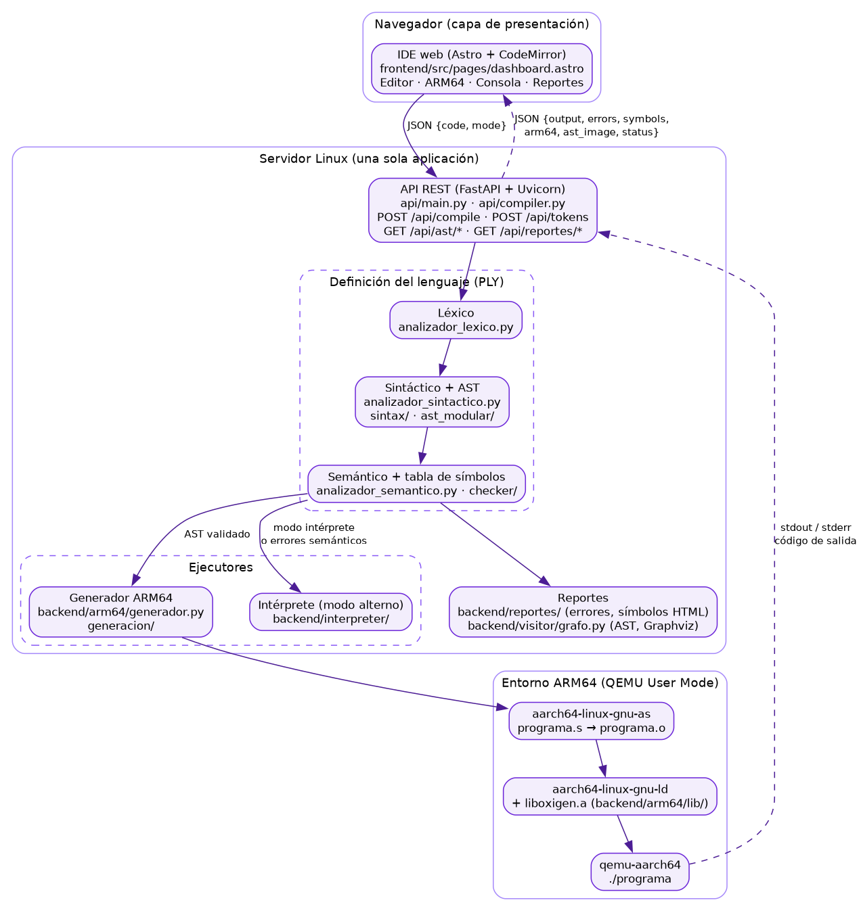

# Arquitectura

**Volver al índice:** [Documentación técnica](DOCUMENTACION_TECNICA.md)

## 1. Introducción

OxigenNative es un compilador para un lenguaje educativo inspirado en Rust. Traduce cada programa
a ensamblador **ARM64 (AArch64)**, lo ensambla y enlaza con las herramientas GNU, y lo ejecuta con
**QEMU User Mode**. Conserva además el **intérprete** del Proyecto 1 como modo alterno de ejecución.
Se usa desde un IDE web que muestra el código fuente, el ensamblador generado, la salida del
programa y los reportes de errores, de tabla de símbolos y del AST.

## 2. Monolito cliente/servidor

La aplicación es un monolito con cuatro componentes que se despliegan juntos en un servidor Linux:

| Componente | Implementación | Responsabilidad |
|---|---|---|
| Presentación | `frontend/` (Astro, TypeScript, CodeMirror) | Editor, panel ARM64, consola y reportes en una sola página |
| Lógica y servicios | `api/` (FastAPI + Uvicorn, puerto 8000) | Recibe el código, coordina las etapas y responde en JSON |
| Definición del lenguaje | `backend/analizador_lexico.py`, `backend/analizador_sintactico.py`, `backend/sintax/`, `backend/ast_modular/`, `backend/checker/` | Reglas léxicas y sintácticas en PLY, AST propio, análisis semántico y tabla de símbolos |
| Entorno ARM64 | `backend/arm64/` + `aarch64-linux-gnu-as`, `aarch64-linux-gnu-ld`, `qemu-aarch64` | Generar `programa.s`, ensamblar, enlazar con `liboxigen.a` y ejecutar |

El cliente y el servidor se comunican por HTTP con JSON (ver [API](api.md)). Dentro del servidor,
las etapas se ejecutan en secuencia dentro del mismo proceso, salvo las herramientas externas
(`as`, `ld`, `qemu-aarch64`), que se lanzan como subprocesos.

## 3. Flujo de una compilación

`api/compiler.py:compilar_codigo(codigo, modo)` orquesta todo:

1. **Análisis léxico y sintáctico.** `parser.parse(codigo)` construye el AST. PLY pide los tokens
   al lexer a medida que los necesita. Los errores se acumulan en `backend/errores.py` y el parser
   se recupera en la siguiente instrucción (`instruccion : error`).
2. **Análisis semántico.** `AnalizadorSemantico` declara primero todas las funciones y structs,
   y luego recorre el AST: valida tipos, ámbitos, mutabilidad y llamadas, y llena la
   `TablaSimbolos`. Anota en cada nodo su tipo (`nodo.tipo`) y el símbolo que usa (`nodo.sym_id`).
3. **AST en Graphviz.** `VisitarGrafo` escribe el árbol en DOT y lo renderiza a PNG.
4. **Ejecución**, según el modo:
   - **ARM64** (por omisión): si no hay errores, `GeneradorARM64` produce `programa.s` y el
     pipeline lo ensambla, enlaza y ejecuta en QEMU. Si hay errores semánticos, pero no léxicos ni
     sintácticos, el programa se ejecuta con el intérprete, como piden los ejemplos de
     inmutabilidad y de operadores aritméticos del enunciado. Con errores léxicos o sintácticos no se ejecuta.
   - **Intérprete**: el recorrido del AST del Proyecto 1 (ver [ejecución](ejecucion.md)).
5. **Reportes.** La tabla de errores con el formato del enunciado (ver [errores](errores.md)), la
   tabla de símbolos con su reporte HTML y el mensaje de estado de la consola.

El diagrama completo del flujo está en [diagramas](diagramas.md#flujo-de-procesamiento).

## 4. Organización del código

### 4.1 Modularización por construcción del lenguaje

Cada construcción tiene un archivo espejo en cada capa:

| Capa | Directorio | Contenido |
|---|---|---|
| Gramática | `backend/sintax/` | Reglas de producción `p_*` de PLY |
| AST | `backend/ast_modular/` | Clases de nodos (subclases de `Nodo`) |
| Semántica | `backend/checker/` | `visitar_*` de validación y la tabla de símbolos |
| Intérprete | `backend/interpreter/` | `visitar_*` de ejecución |
| Generación | `backend/arm64/generacion/` | `visitar_*` que emiten ARM64 |
| Biblioteca | `backend/arm64/lib/<tema>/` | Una rutina `ox_*` por archivo `.s` |

### 4.2 Recorridos por reflexión

`backend/recorrer_ast.py:RecorrerAST.visitar(nodo)` busca el método `visitar_<NombreClase>` y lo
llama. Cuatro clases lo extienden: `AnalizadorSemantico`, `Interprete`, `GeneradorARM64` y
`VisitarGrafo`. Cada una importa sus funciones `visitar_*` desde su carpeta y las asigna como
atributos de clase (*mixins*), por ejemplo `visitar_Variable = visitar_Variable`.

El método de respaldo `_visitar_generico` se comporta distinto en cada recorrido:

- El grafo lo usa para dibujar cualquier nodo.
- El checker y el intérprete lo ignoran.
- El generador ARM64 **lanza un error**. Un nodo sin traducción no debe producir código vacío
  en silencio.

### 4.3 Paquetes con un módulo por responsabilidad

- `backend/arm64/pipeline/`: `compilar.py`, `resultado.py`, `carpetas.py`, `herramientas.py`,
  `biblioteca.py`, `ensamblado.py`, `enlace.py` y `ejecucion.py`.
- `api/`: `compiler.py` orquesta; `modo_arm64.py`, `modo_interprete.py` y `estado.py` resuelven
  cada modo y el mensaje de la consola.
- `backend/reportes/`: `errores.py` (tabla de errores), `simbolos.py` y `simbolos_html.py`
  (tabla de símbolos), `interprete_valores.py` y `formato_valor.py` (columna «Valor»).

La estructura completa de carpetas está en [estructura](estructura.md).

## 5. Estado compartido y concurrencia

`backend/errores.py` guarda los errores léxicos y sintácticos en una lista de módulo, que
`compilar_codigo` vacía al empezar. El lexer y el parser de PLY también son objetos de módulo.
Por eso el compilador atiende **una compilación a la vez**: no es seguro llamarlo desde dos hilos
simultáneos. Para un IDE de un solo usuario es suficiente. Cada ejecución ARM64 usa su propia
carpeta `build/arm64/<uuid>/`, así que los archivos generados nunca chocan.
