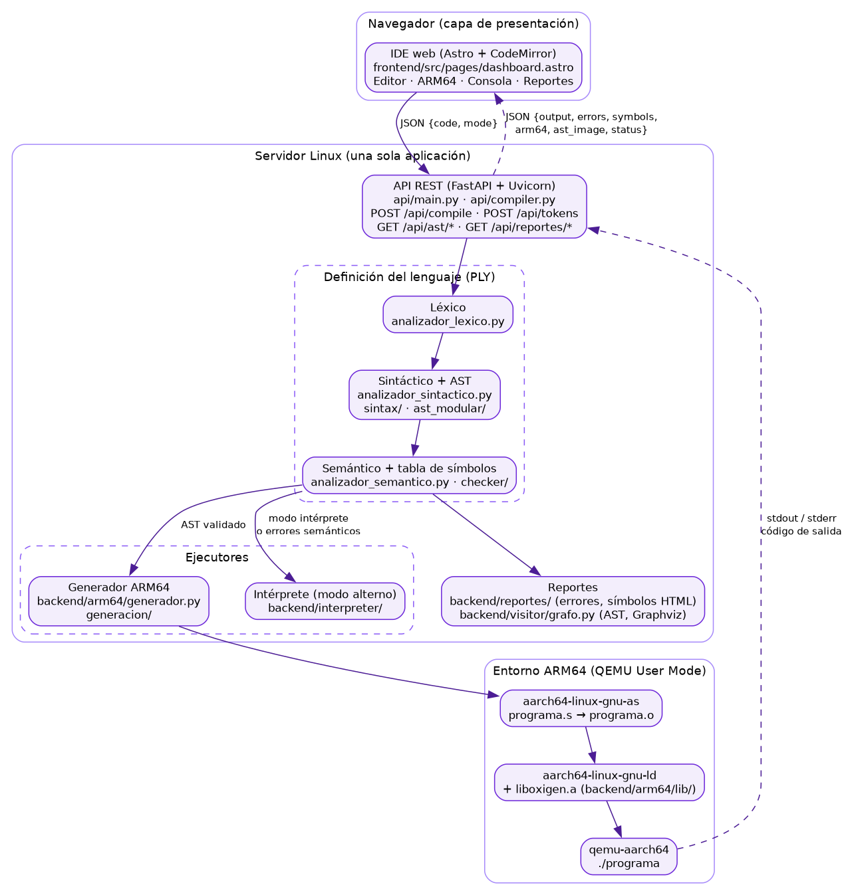
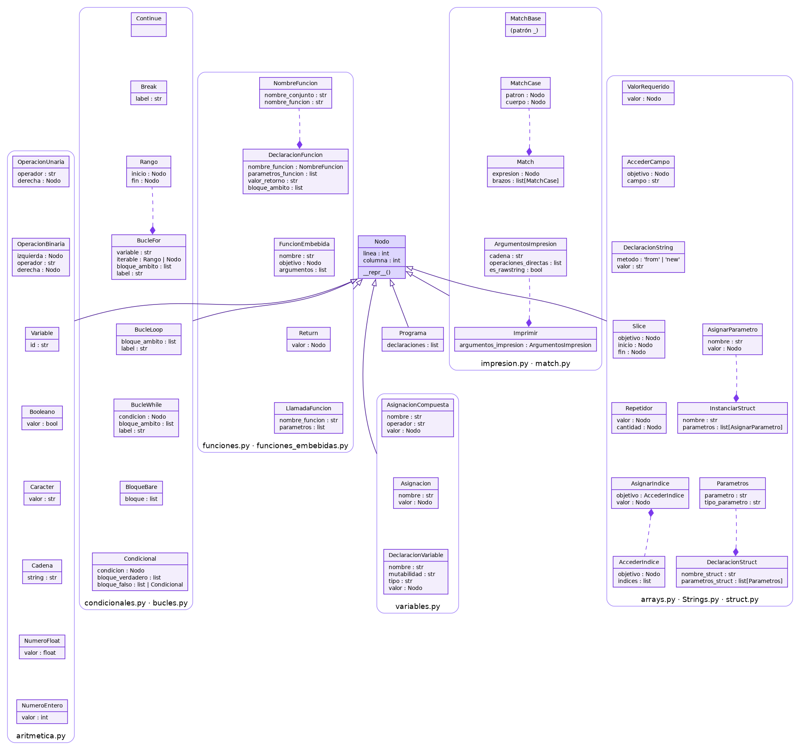
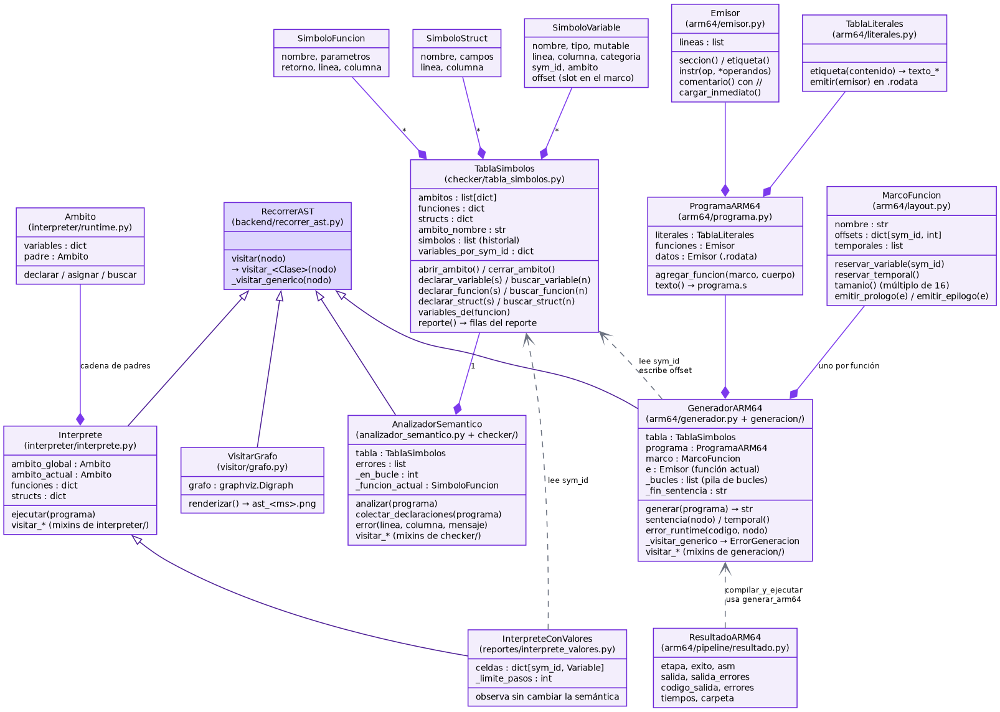
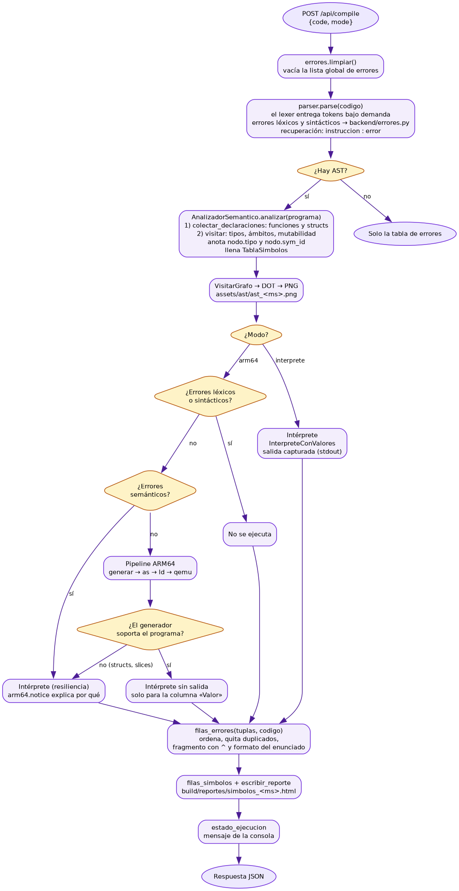
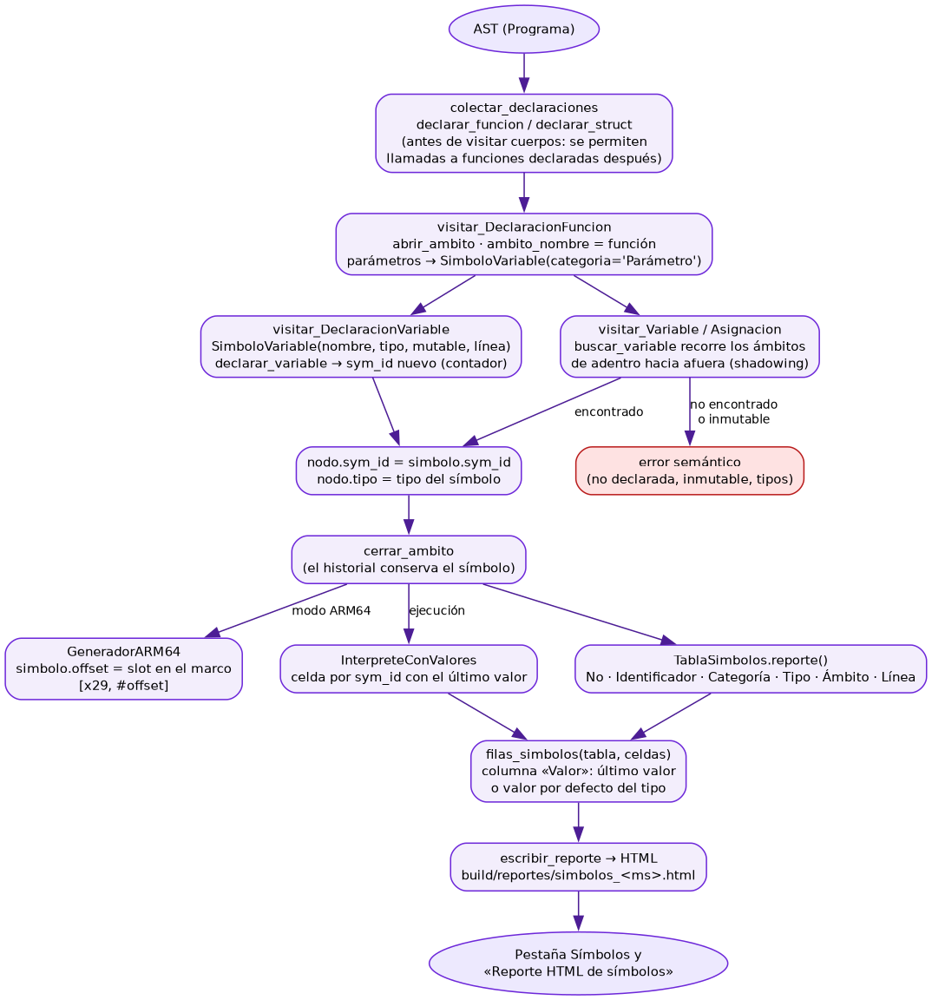
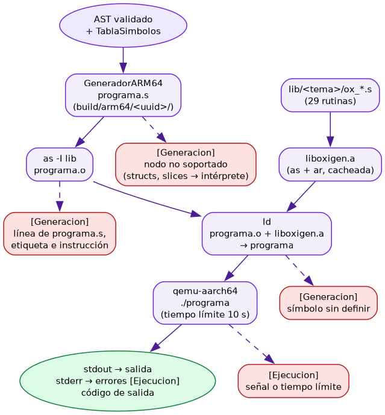

# Diagramas de clases y de flujo

**Volver al índice:** [Documentación técnica](DOCUMENTACION_TECNICA.md)

Diagramas que pide el enunciado: clases, y flujo de procesamiento del AST y de la tabla de
símbolos. Cada uno está escrito en Graphviz (archivo `.dot` en `docs/diagramas/`) y renderizado a
PNG. Para regenerarlos después de un cambio:

```sh
cd docs/diagramas
for f in *.dot; do dot -Tpng -Gdpi=110 "$f" -o "${f%.dot}.png"; done
```

## Arquitectura

Componentes del monolito cliente/servidor y la comunicación entre ellos.



Fuente: [arquitectura.dot](diagramas/arquitectura.dot)

## Diagrama de clases del AST

Todos los nodos heredan de `Nodo`, que guarda la línea y la columna de la construcción en el código
fuente. Los nodos están agrupados por el módulo de `backend/ast_modular/` donde se definen. Las
líneas punteadas con rombo marcan las composiciones más relevantes. El checker agrega a algunos
nodos los atributos `tipo` y `sym_id`.



Fuente: [clases_ast.dot](diagramas/clases_ast.dot)

## Diagrama de clases del compilador

Los cuatro recorredores del AST (`AnalizadorSemantico`, `Interprete`, `GeneradorARM64` y
`VisitarGrafo`) heredan de `RecorrerAST`. La `TablaSimbolos` la llena el checker. El generador la
lee para ubicar cada variable en su slot de pila y escribe allí el `offset`.
`InterpreteConValores` la lee para calcular la columna «Valor» del reporte.



Fuente: [clases_compilador.dot](diagramas/clases_compilador.dot)

## Flujo de procesamiento

Recorrido completo de `compilar_codigo`: análisis, AST, decisión de modo, ejecución y reportes.



Fuente: [flujo_compilacion.dot](diagramas/flujo_compilacion.dot)

## Flujo de la tabla de símbolos

Cómo nace cada símbolo en el checker, cómo lo usan el generador ARM64 y el intérprete, y cómo
termina en el reporte HTML de la tabla de símbolos.



Fuente: [flujo_tabla_simbolos.dot](diagramas/flujo_tabla_simbolos.dot)

## Pipeline ARM64

Del AST validado a la salida en QEMU, con el error que produce cada etapa si falla.



Fuente: [flujo_arm64.dot](diagramas/flujo_arm64.dot)
