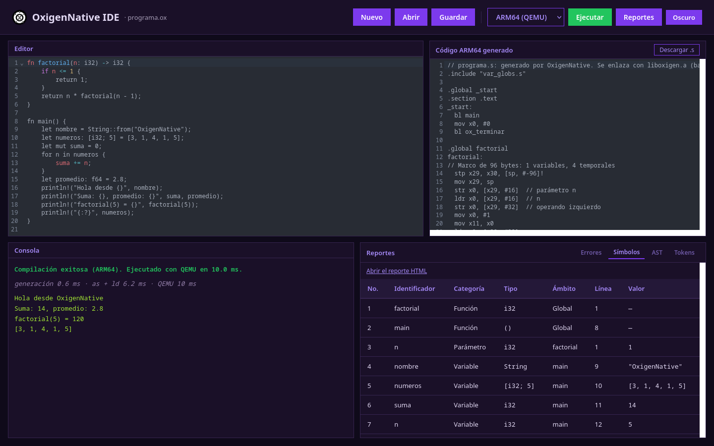
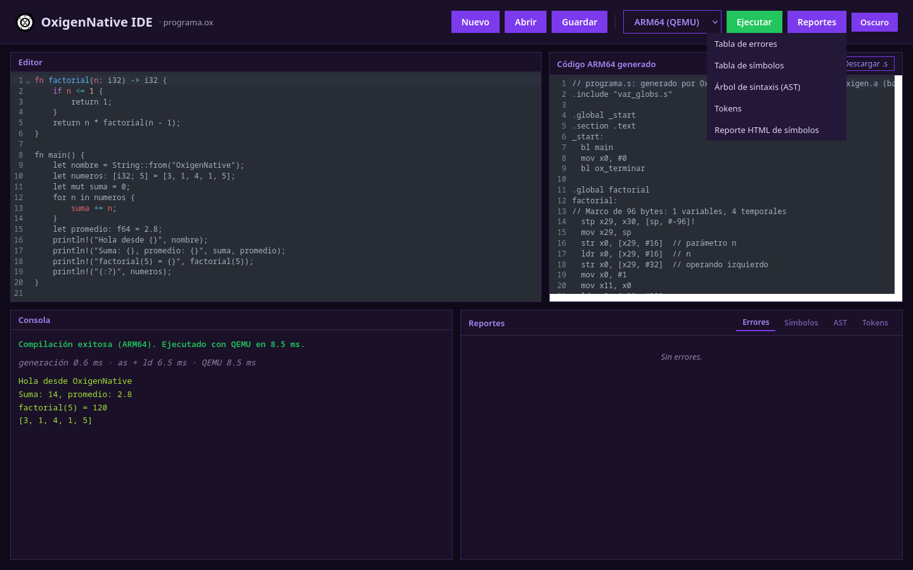
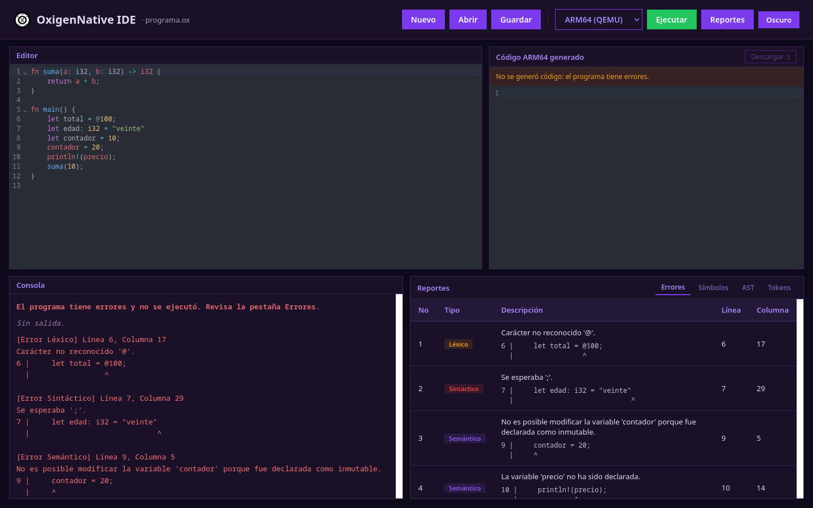
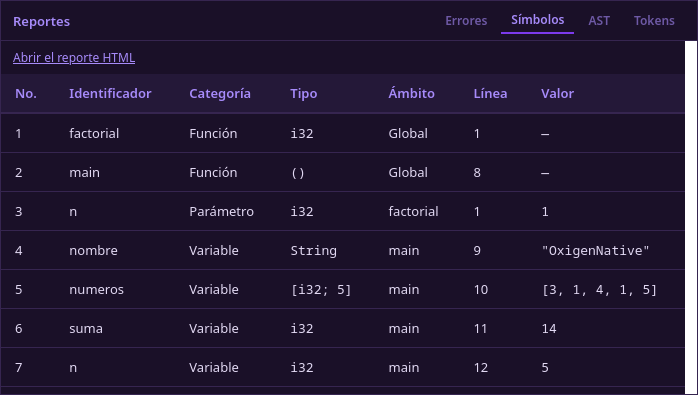
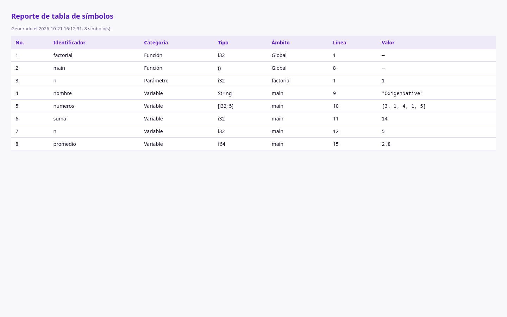
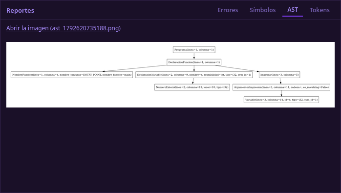
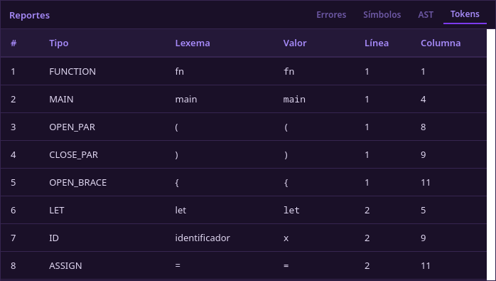
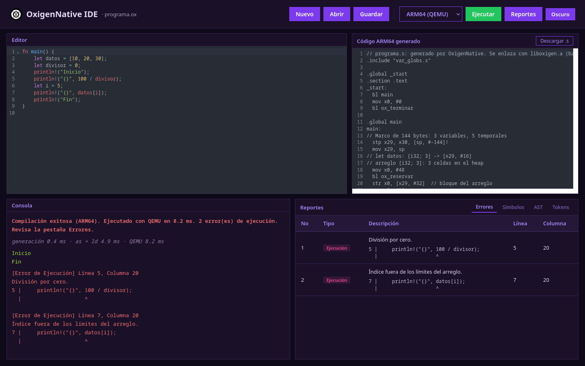
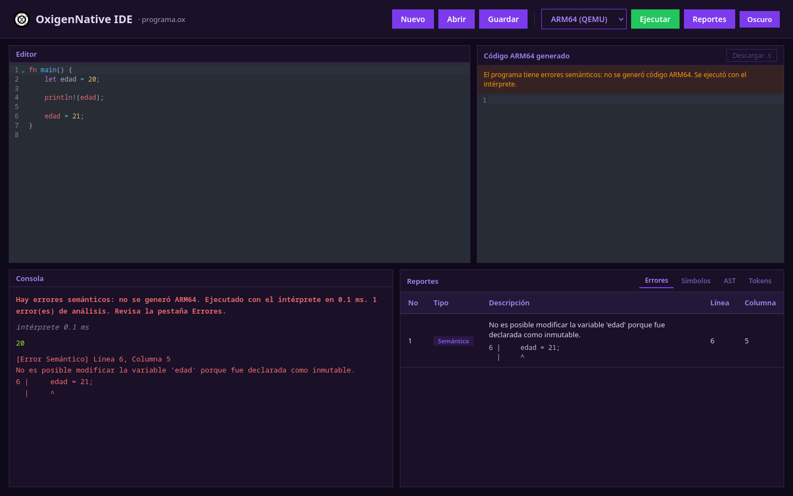
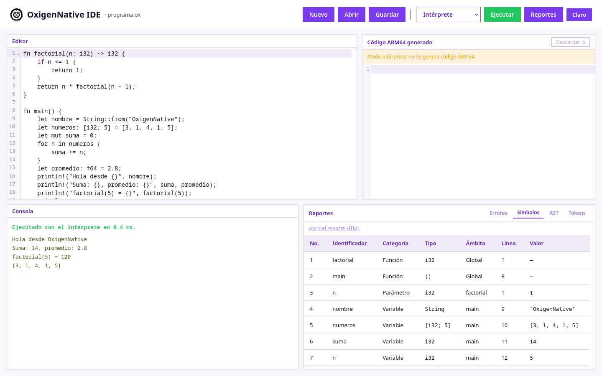

# Manual de usuario — OxigenNative

**Volver al índice:** [Documentación técnica](../DOCUMENTACION_TECNICA.md)

OxigenNative es un compilador para un lenguaje inspirado en Rust. Desde un IDE web se escribe un
programa, se compila a ensamblador ARM64, se ejecuta con QEMU y se revisan los reportes de
errores, de tabla de símbolos y del árbol de sintaxis (AST). Este manual explica cómo instalarlo,
usarlo y leer cada reporte.

## Contenido

1. [Requisitos](#1-requisitos)
2. [Instalación paso a paso](#2-instalación-paso-a-paso)
3. [Iniciar y detener la aplicación](#3-iniciar-y-detener-la-aplicación)
4. [La interfaz](#4-la-interfaz)
5. [Crear, abrir, editar y guardar](#5-crear-abrir-editar-y-guardar)
6. [Ejecutar un programa](#6-ejecutar-un-programa)
7. [Leer los reportes](#7-leer-los-reportes)
8. [Sesiones de uso](#8-sesiones-de-uso)
9. [Solución de problemas](#9-solución-de-problemas)
10. [Referencia rápida del lenguaje](#10-referencia-rápida-del-lenguaje)

## 1. Requisitos

| Componente | Versión | Para qué |
|---|---|---|
| Linux | cualquier distribución reciente | sistema operativo del servidor |
| Python | 3.14 o superior | compilador y API |
| uv | reciente | entorno virtual y dependencias de Python |
| Node.js | **22.12 o superior** | IDE web (Astro 7 no arranca con versiones menores) |
| Graphviz | reciente | imagen del AST (`dot`) |
| binutils para AArch64 | 2.40 o superior | `aarch64-linux-gnu-as`, `-ld` y `-ar` |
| QEMU User Mode | 8 o superior | `qemu-aarch64`, que ejecuta el binario ARM64 |
| Navegador | Firefox, Chrome o similar | usar el IDE |

El proyecto se probó con Python 3.14.8, Node 24.18, GNU Binutils 2.47 y QEMU 11.1.

## 2. Instalación paso a paso

### 2.1 Obtener el código

```sh
git clone https://github.com/Angelius6573/OLC2_B_P2_2S2026.git OxigenNative
cd OxigenNative
```

### 2.2 Instalar las dependencias del sistema

**Arch Linux y derivadas (Manjaro, EndeavourOS, CachyOS):**

```sh
sudo pacman -S python uv graphviz nodejs npm aarch64-linux-gnu-binutils qemu-user
```

**Debian, Ubuntu y derivadas (Linux Mint, Pop!_OS, Zorin OS):**

```sh
sudo apt update
sudo apt install python3 graphviz nodejs npm binutils-aarch64-linux-gnu qemu-user
curl -LsSf https://astral.sh/uv/install.sh | sh
```

Si la distribución no ofrece Python 3.14, `uv` lo descarga solo en el paso 2.3.

### 2.3 Instalar las dependencias de Python

```sh
uv sync
```

Esto crea `.venv/` con PLY, FastAPI, Uvicorn y la biblioteca de Graphviz.

### 2.4 Instalar las dependencias del IDE web

Primero hay que comprobar la versión de Node:

```sh
node --version          # debe ser v22.12 o mayor
```

Si es menor, se puede instalar una versión nueva con [nvm](https://github.com/nvm-sh/nvm):

```sh
nvm install 24
nvm use 24
```

Luego:

```sh
cd frontend
npm install
cd ..
```

### 2.5 Verificar la cadena ARM64

```sh
aarch64-linux-gnu-as --version | head -1
aarch64-linux-gnu-ld --version | head -1
qemu-aarch64 --version | head -1
dot -V
```

Los cuatro comandos deben responder con su versión. Si falta alguna herramienta, el IDE lo indica
al ejecutar en modo ARM64 («Faltan herramientas: …»).

## 3. Iniciar y detener la aplicación

Desde la raíz del proyecto:

```sh
uv run start.sh
```

El script levanta dos servidores:

| Servidor | Dirección | Registro |
|---|---|---|
| API (FastAPI) | `http://localhost:8000` | `/tmp/fastapi.log` |
| IDE web (Astro) | `http://localhost:4321` | `/tmp/astro.log` |

Abrir **`http://localhost:4321`** en el navegador; la página redirige al IDE. Para detener ambos
servidores, presionar `Ctrl+C` en la terminal del script.

## 4. La interfaz



La pantalla se divide en cuatro áreas:

| Área | Ubicación | Contenido |
|---|---|---|
| **Barra de herramientas** | arriba | Nuevo, Abrir, Guardar, selector de modo, Ejecutar, Reportes y tema claro u oscuro. A la izquierda, el nombre del archivo abierto |
| **Editor** | centro izquierda | El código fuente, con números de línea, resaltado y cierre automático de paréntesis |
| **Código ARM64 generado** | centro derecha | El `programa.s` que se ensambló y ejecutó en QEMU, con números de línea y el botón «Descargar .s» |
| **Consola** | abajo izquierda | Mensaje de estado, tiempos de cada etapa, salida del programa y errores |
| **Reportes** | abajo derecha | Pestañas Errores, Símbolos, AST y Tokens |

## 5. Crear, abrir, editar y guardar

- **Nuevo:** vacía el editor y los reportes. Si hay código escrito, pide confirmación. El archivo
  se llama `programa.ox`.
- **Abrir:** muestra el selector de archivos del sistema. Al elegir un `.ox` (o `.txt`), su
  contenido se carga en el editor y su nombre aparece en la barra. En `docs/manual/ejemplos/` hay
  programas listos para abrir.
- **Editar:** se escribe directamente en el editor. Atajos útiles: `Ctrl+Z` / `Ctrl+Y` deshacen y
  rehacen, `Ctrl+F` busca, y `Ctrl+Enter` ejecuta.
- **Guardar:** descarga el código del editor como un archivo con el nombre actual (por ejemplo
  `programa.ox`) en la carpeta de descargas del navegador.

El editor guarda el código en el navegador mientras se escribe. Si se recarga la página, el último
código sigue ahí.

## 6. Ejecutar un programa

1. Elegir el modo en el selector de la barra:
   - **ARM64 (QEMU)** (por omisión): compila a ARM64, ensambla, enlaza y ejecuta con QEMU.
   - **Intérprete**: ejecuta el AST directamente en Python, sin generar ensamblador.
2. Presionar **Ejecutar** (o `Ctrl+Enter`).
3. Leer el resultado en la consola:
   - **Mensaje de estado** en verde si todo salió bien, o en rojo si hubo errores. Por ejemplo:
     «Compilación exitosa (ARM64). Ejecutado con QEMU en 10.0 ms.»
   - **Tiempos** de cada etapa: generación, `as` + `ld` y QEMU.
   - **Salida** del programa, en verde.
   - **Errores**, en rojo, con el formato del enunciado.

Si el programa tiene errores, la pestaña **Errores** se abre sola.

### Cuándo se ejecuta con el intérprete aunque el modo sea ARM64

El aviso naranja del panel ARM64 explica estos casos:

| Situación | Qué pasa |
|---|---|
| Errores léxicos o sintácticos | No se ejecuta. «No se generó código: el programa tiene errores.» |
| Errores semánticos | No se genera ARM64; el programa se ejecuta con el intérprete para mostrar lo que sí funciona |
| Structs o slices | El generador ARM64 no los soporta; se ejecuta con el intérprete |

### El panel «Código ARM64 generado»

Muestra exactamente el `programa.s` que se ejecutó. Cada función empieza con su etiqueta
(`main:`), un comentario con el tamaño de su marco de pila y el prólogo (`stp x29, x30, …`). Cada
`let` lleva un comentario con el slot de la variable (`// let x: i32 -> [x29, #16]`). **Descargar
.s** guarda el archivo para ensamblarlo a mano:

```sh
aarch64-linux-gnu-as -I backend/arm64/lib -o programa.o programa.s
aarch64-linux-gnu-ld -o programa programa.o build/arm64/liboxigen.a
qemu-aarch64 ./programa
```

## 7. Leer los reportes

Los reportes están en las pestañas del panel inferior derecho y en el botón **Reportes** de la
barra, que lleva a cada pestaña y abre el reporte HTML de símbolos.



### 7.1 Errores



Es la tabla de análisis de errores. Cada fila tiene:

| Columna | Significado |
|---|---|
| **No** | Número del error en la ejecución |
| **Tipo** | Léxico, Sintáctico, Semántico, Ejecución o Generación, cada uno con su color |
| **Descripción** | Qué está mal y, debajo, la línea del código con un `^` en la columna exacta |
| **Línea / Columna** | Posición del error, contando desde 1 |

**Un clic en una fila lleva el cursor del editor a esa línea y columna.**

Los errores aparecen ordenados por posición, y en una sola ejecución pueden aparecer errores de
las tres fases. Cómo leer cada tipo:

| Tipo | Cuándo aparece | Ejemplo |
|---|---|---|
| Léxico | Un símbolo que no pertenece al lenguaje, o un `/*` sin `*/` | `Carácter no reconocido '@'.` |
| Sintáctico | El código no sigue la gramática | `Se esperaba ';'.` — la columna señala justo después del último token de la línea |
| Semántico | El código está bien escrito pero no tiene sentido | `La variable 'precio' no ha sido declarada.` |
| Ejecución | Falla al correr | `División por cero.` — el programa **sigue** con la siguiente sentencia |
| Generación | Falla el ensamblado o el enlace | Muestra la línea de `programa.s` y la instrucción |

En la consola, los mismos errores aparecen como texto:

```
[Error Semántico] Línea 10, Columna 14
La variable 'precio' no ha sido declarada.
10 |     println!(precio);
   |              ^
```

### 7.2 Tabla de símbolos



Lista cada identificador registrado durante el análisis:

| Columna | Significado |
|---|---|
| **No.** | Orden de registro: primero funciones y structs, luego variables |
| **Identificador** | Nombre declarado |
| **Categoría** | Función, Struct, Variable o Parámetro |
| **Tipo** | `i32`, `f64`, `bool`, `char`, `String`, `[i32; 5]`… En una función, su tipo de retorno; `()` si no devuelve nada |
| **Ámbito** | `Global` para funciones y structs; el nombre de la función para variables y parámetros |
| **Línea** | Línea de la declaración |
| **Valor** | El último valor que tuvo la variable al terminar la ejecución; si nunca se asignó, el valor por defecto de su tipo. Las funciones muestran `—` |

Una variable que se declara dos veces con el mismo nombre (*shadowing*) aparece dos veces, porque
son dos símbolos distintos. Un parámetro de una función recursiva muestra el valor de la última
llamada.

El enlace **«Abrir el reporte HTML»** (o Reportes → «Reporte HTML de símbolos») abre el reporte
en una pestaña nueva:



### 7.3 AST



Muestra el árbol de sintaxis abstracta generado con Graphviz. La raíz es `Programa`. Cada
nodo indica su clase y sus datos: línea, columna, nombre, valor y, después del análisis, su
`tipo` y su `sym_id`. «Abrir la imagen» la muestra a tamaño completo, útil en programas largos.

### 7.4 Tokens



Lista los tokens que reconoce el analizador léxico, con su tipo, lexema, valor, línea y columna.
Sirve para ver cómo se separa el código antes del análisis sintáctico.

## 8. Sesiones de uso

### 8.1 Programa correcto en ARM64

Abrir `docs/manual/ejemplos/01_ejemplo.ox`:

```rust
fn factorial(n: i32) -> i32 {
    if n <= 1 {
        return 1;
    }
    return n * factorial(n - 1);
}

fn main() {
    let nombre = String::from("OxigenNative");
    let numeros: [i32; 5] = [3, 1, 4, 1, 5];
    let mut suma = 0;
    for n in numeros {
        suma += n;
    }
    let promedio: f64 = 2.8;
    println!("Hola desde {}", nombre);
    println!("Suma: {}, promedio: {}", suma, promedio);
    println!("factorial(5) = {}", factorial(5));
    println!("{:?}", numeros);
}
```

Con el modo **ARM64 (QEMU)**, presionar **Ejecutar**. La consola muestra:

```
Compilación exitosa (ARM64). Ejecutado con QEMU en 10.0 ms.
Hola desde OxigenNative
Suma: 14, promedio: 2.8
factorial(5) = 120
[3, 1, 4, 1, 5]
```

El panel ARM64 tiene el código de `factorial` y `main`, y la pestaña Símbolos muestra `suma = 14`
y `nombre = "OxigenNative"` (ver la [vista general](#4-la-interfaz)).

### 8.2 Encontrar y corregir errores

Abrir `docs/manual/ejemplos/02_errores.ox`:

```rust
fn suma(a: i32, b: i32) -> i32 {
    return a + b;
}

fn main() {
    let total = @100;
    let edad: i32 = "veinte"
    let contador = 10;
    contador = 20;
    println!(precio);
    suma(10);
}
```

Al ejecutar, la tabla de errores muestra cinco errores de las tres fases (ver la
[captura](#71-errores)):

| No | Tipo | Descripción | Línea | Columna |
|---|---|---|---|---|
| 1 | Léxico | Carácter no reconocido '@'. | 6 | 17 |
| 2 | Sintáctico | Se esperaba ';'. | 7 | 29 |
| 3 | Semántico | No es posible modificar la variable 'contador' porque fue declarada como inmutable. | 9 | 5 |
| 4 | Semántico | La variable 'precio' no ha sido declarada. | 10 | 14 |
| 5 | Semántico | La función 'suma' esperaba 2 argumentos, pero recibió 1. | 11 | 5 |

Para corregirlos, hacer clic en cada fila para ir a la línea y:

1. quitar el `@` (`let total = 100;`);
2. agregar el `;` al final de la línea 7 y usar un número (`let edad: i32 = 20;`);
3. declarar `contador` con `let mut`;
4. declarar `precio` antes de usarlo, por ejemplo `let precio = 15;`;
5. pasar los dos argumentos: `suma(10, 5);`.

Al ejecutar otra vez, la consola muestra «Compilación exitosa (ARM64)» y la tabla «Sin errores».

### 8.3 Errores de ejecución sin detener el programa

Abrir `docs/manual/ejemplos/03_error_ejecucion.ox`:

```rust
fn main() {
    let datos = [10, 20, 30];
    let divisor = 0;
    println!("Inicio");
    println!("{}", 100 / divisor);
    let i = 5;
    println!("{}", datos[i]);
    println!("Fin");
}
```



El programa se compila y se ejecuta. La división entre cero y el índice fuera de rango solo se
detectan al correr, y ninguno detiene el programa: la sentencia que falla se omite y el resto
continúa. La salida es `Inicio` y `Fin`, y la tabla muestra los dos errores de ejecución con su
posición.

### 8.4 Error semántico en modo ARM64

Abrir `docs/manual/ejemplos/04_inmutable.ox` (el ejemplo de inmutabilidad del enunciado):

```rust
fn main() {
    let edad = 20;

    println!(edad);

    edad = 21;
}
```



Por el error semántico no se genera ARM64. El programa se ejecuta con el intérprete, así que se
ve la salida `20` y, después, el error. El aviso naranja del panel ARM64 lo explica.

### 8.5 Modo intérprete y tema claro



Con el selector en **Intérprete**, el panel ARM64 indica que en ese modo no se genera código. El
botón de la esquina cambia entre tema oscuro y claro, también en los editores; la preferencia se
recuerda.

## 9. Solución de problemas

| Síntoma | Causa y solución |
|---|---|
| «No se pudo contactar al servidor» | La API no está corriendo. Revisar `/tmp/fastapi.log` y volver a iniciar con `uv run start.sh` |
| El IDE no abre en `localhost:4321` | Node es menor que 22.12. Revisar `/tmp/astro.log` e instalar una versión nueva (sección 2.4) |
| «Faltan herramientas: aarch64-linux-gnu-as, …» | Instalar binutils para AArch64 y QEMU User (sección 2.2) |
| La pestaña AST no muestra imagen | Falta Graphviz: `dot -V` debe responder |
| «Error: .venv no encontrado» al iniciar | Ejecutar `uv sync` en la raíz del proyecto |
| «El programa no terminó en 10 s y se detuvo» | Hay un bucle infinito; QEMU se detiene a los 10 segundos |
| «… is already defined» al ensamblar | Una función se llama igual que una etiqueta que genera el compilador (`fin_si_1`, `bucle_while_2`…). Cambiarle el nombre |
| En modo ARM64 `println!` no imprime nada | Una función del usuario empieza con `ox_` (por ejemplo `ox_print`) y reemplaza a la rutina interna del mismo nombre. No usar el prefijo `ox_` en funciones propias |

## 10. Referencia rápida del lenguaje

```rust
// Comentario de línea
/* Comentario
   de bloque */

struct Punto { x: i32, y: i32 }              // structs (en ARM64 se ejecutan con el intérprete)

fn sumar(a: i32, b: i32) -> i32 {            // función con retorno
    return a + b;
}

fn main() {                                  // punto de entrada
    let x: i32 = 10;                         // tipos: i32, f64, bool, char, String, [T; N]
    let mut y = 2.5;                         // mut permite reasignar
    y += 1.0;                                // += -= *= /= %=
    let activo = x > 5 && !(y < 1.0);        // relacionales y lógicos
    let nombre = String::from("Ana");
    let mut texto = String::new();
    texto.push_str("hola");
    let m = [[1, 2], [3, 4]];                // arreglos multidimensionales
    let ceros = [0; 5];                      // repetidor

    if x > 5 { println!("mayor"); } else { println!("menor"); }
    while x > 0 { break; }
    'externo: loop { break 'externo; }
    for i in 0..3 { println!("{}", i); }
    for v in ceros { println!("{}", v); }
    match x { 1 => println!("uno"), _ => println!("otro"), }

    println!("{} {:?} {}", sumar(1, 2), nombre, m[1][0]);
    println!(nombre.len(), texto.to_uppercase(), typeof(y));
    // También: contains, replace, split, reverse, to_lowercase, random(1, 10)
}
```

La gramática completa está en la [documentación técnica](../gramatica.md).
